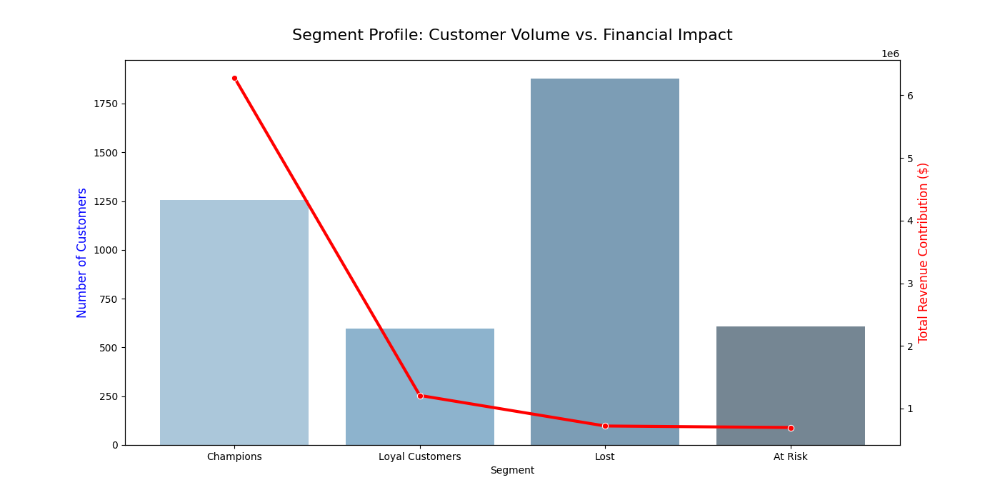

# Customer Segmentation System
### RFM Analysis · Rule-Based Scoring · Segment Profiling

> A consulting-style customer analytics pipeline that turns raw e-commerce transactions into segments a marketing team can act on — built on real UK retail data.

**TL;DR** — On 4,338 real customers, the top 29% ("Champions") generate **70% of revenue**. The notebook cleans 541,909 raw transactions, scores every customer on Recency, Frequency and Monetary value, and maps them to four segments with a concrete play for each.

  

---

## Business Problem

Most retail and e-commerce businesses treat all customers the same. They send the same promotions, the same emails, the same offers — to Champions who buy every month and to customers who haven't purchased in six months.

This project replaces that one-size-fits-all approach with a **data-driven segmentation** that answers two questions:

1. **Who are my best customers, and what makes them different?**
2. **Which customers are slipping away, and is it worth winning them back?**

---

## Results

### RFM Segmentation — UCI Online Retail (Dec 2010 – Dec 2011 · 541,909 transactions · 4,338 customers)

| Segment | Customers | Revenue share | Avg days since last order | Avg orders in the year |
|---|---|---|---|---|
| **Champions** | 1,254 (29%) | **70.5%** | 14 | 9.3 |
| Loyal Customers | 596 (14%) | 13.6% | 91 | 5.3 |
| At Risk | 609 (14%) | 7.8% | 171 | 1.9 |
| Lost | 1,879 (43%) | 8.1% | 120 | 1.4 |



### Key Business Insights

**29% of customers generate 70% of revenue.** Champions ordered about 9 times in the year and most recently two weeks before the snapshot. Retention spend (VIP program, early access, personal outreach) on this group protects most of the business.

**Loyal Customers are the growth lever.** They order often (5+ times) but have not bought for about three months. Nudging them back to a Champion rhythm is cheaper than winning back lapsed buyers.

**At Risk is smaller than it looks.** These 609 customers scored in the top three quintiles on frequency or spend, but ordered only about twice on average, and their last order is almost six months old. They are worth one targeted reactivation campaign, measured against a control group, rather than a large discount budget.

---

## Pipeline Architecture

```
Raw Data (UCI Online Retail .xlsx)
        │
        ▼
[ Data Cleaning ]
  Remove cancellations (Invoice starts with 'C')
  Drop missing Customer IDs
  Remove negative quantities and prices
  Compute line-level spend = Quantity × UnitPrice
        │
        ▼
[ RFM Computation ]
  Recency   = days since last purchase
  Frequency = unique invoice count
  Monetary  = total revenue per customer
        │
        ▼
[ RFM Scoring ]
  Quintile scoring (1–5) per metric
  Recency reversed: lower recency = higher score
  Segment labels: Champions · Loyal · At Risk · Lost
        │
        ▼
[ Visualization ]
  Customer volume vs. revenue contribution per segment
```

---

## RFM Methodology

**Snapshot date** = max(InvoiceDate) + 1 day

| Metric | Definition | Scoring |
|---|---|---|
| Recency | Days since last purchase | Lower = better → Score 5→1 |
| Frequency | Unique invoices | Higher = better → Score 1→5 |
| Monetary | Total spend (£) | Higher = better → Score 1→5 |

**Segment Logic**

```python
if r >= 4 and (f >= 4 or m >= 4): → Champions
elif f >= 4:                       → Loyal Customers
elif r <= 2 and (f >= 3 or m >= 3):→ At Risk
else:                              → Lost
```

**Limits.** Segments come from business rules on quintiles, not from a statistical model, so thresholds are a judgment call. "Days since last order" is a snapshot, not a purchase interval. The data covers one year of one retailer, mostly wholesale buyers.

---

## Actionable Recommendations

| Segment | Strategy |
|---|---|
| **Champions** | VIP loyalty program. Early product access. Personalized thank-you outreach. High retention ROI. |
| **Loyal Customers** | Upsell to higher-margin products. Reward consistency. Nudge toward Champion tier. |
| **At Risk** | One reactivation campaign with a time-limited offer, tested against a control group. Survey to understand churn reasons. |
| **Lost** | Low-cost win-back email sequence. If no response after 2 touchpoints, deprioritize. |

---

## How to Run

```bash
git clone https://github.com/e-1305/Customer-Segmentation-System.git
cd Customer-Segmentation-System
python -m venv .venv && source .venv/bin/activate   # Windows: .venv\Scripts\activate
pip install -r requirements.txt
cd notebooks
jupyter notebook CUSTOMER_SEGMENTATION_SYSTEM.ipynb
```

Run all cells. The raw dataset is already in `notebooks/data/`; if it is missing, the notebook downloads it from UCI. Works the same in Google Colab (upload the notebook and the `data/` folder).

---

## Repository Structure

```
Customer-Segmentation-System/
├── notebooks/
│   ├── CUSTOMER_SEGMENTATION_SYSTEM.ipynb   # full pipeline
│   ├── data/
│   │   ├── Online_Retail.xlsx               # raw UCI dataset
│   │   └── transactions.parquet             # cleaned transactions
│   └── results/plots/segment_analysis.png
├── requirements.txt
└── README.md
```

---

## Dataset

[Online Retail — UCI Machine Learning Repository](https://archive.ics.uci.edu/dataset/352/online+retail) (Daqing Chen, 2015), licensed CC BY 4.0.

Real transactions of a UK-based online retailer, 1 Dec 2010 – 9 Dec 2011: 541,909 rows including cancelled orders, missing customer IDs and negative quantities, which the cleaning step removes (397,884 rows kept).

---

## Tech Stack

| Layer | Tools |
|---|---|
| Data processing | pandas, numpy |
| Visualization | matplotlib, seaborn |
| Storage | pyarrow (Parquet) |
| Environment | Jupyter / Google Colab |

---

## Future Work

- **K-Means clustering** on log-transformed RFM features with UMAP visualization, to compare data-driven segments with the rule-based ones
- **Lookalike modeling** with XGBoost to score non-Champion customers by their probability of becoming Champions (AUC-ROC + Precision@K evaluation)
- **Campaign measurement**: uplift test design for the At Risk reactivation campaign

---

## License

Code under the [MIT License](LICENSE). The dataset belongs to its authors (UCI, CC BY 4.0).
